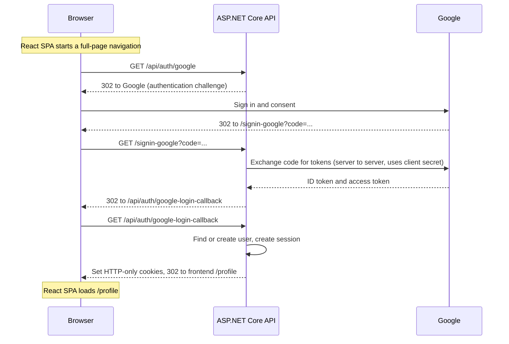
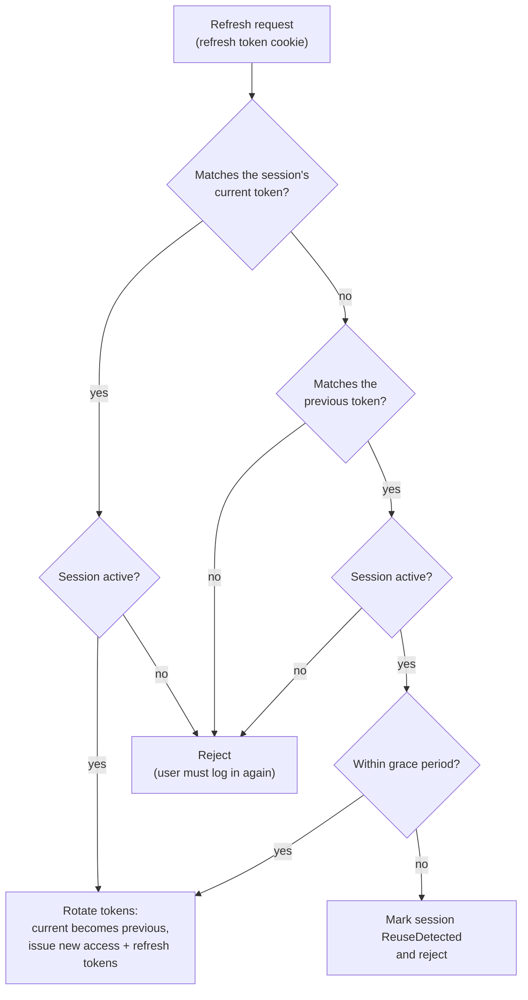
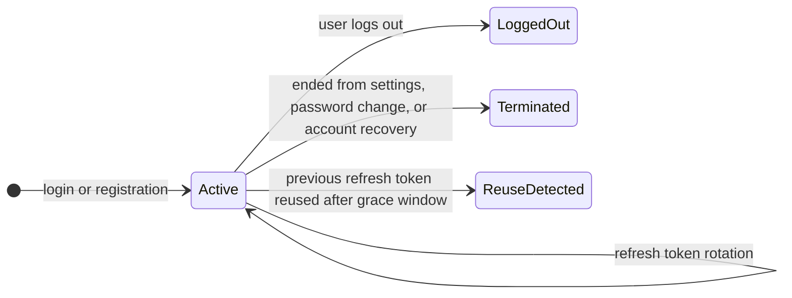

# SocialMediaApp - Social Media Web Application

A full-stack social media platform: users publish posts with images and tags, follow each other, like, save and comment. Built with ASP.NET Core, PostgreSQL, and React, with a hand-built authentication and session-management system at its core.

> **Status:** in active development. All features listed under [Features](#features) are implemented and working locally. The UI is intentionally minimal (functionality first, visual polish later), and the project is not deployed yet. See the [Roadmap](#roadmap) for what is planned and what is deliberately out of scope.

## Table of Contents

- [Tech Stack](#tech-stack)
- [Features](#features)
- [Authentication & Session Design](#authentication--session-design)
- [Design Decisions](#design-decisions)
- [Roadmap](#roadmap)
- [Known Limitations](#known-limitations)
- [Getting Started](#getting-started)
- [License](#license)

## Tech Stack

| Layer | Technologies |
|---|---|
| Backend | ASP.NET Core Web API (with a built-in OpenAPI document), Entity Framework Core, MailKit, ImageSharp |
| Database | PostgreSQL (via Docker Compose) |
| Frontend | React, TypeScript, React Router v7 (SPA mode), SCSS, Oxlint |
| Dev tooling | Docker Compose (PostgreSQL, Mailpit, hot-reloading API and frontend containers) |

## Features

**Accounts & authentication**
- Registration and login with email + password, or via an external provider (Google implemented; the design supports adding more providers)
- Email confirmation on registration (the account is only created after the link is confirmed)
- "Forgot password" and password reset by email
- Linking external providers to an existing account, and adding a password to an account created through a provider
- Profile settings: name, unique user tag, email (confirmed via link sent to the new address), password

**Sessions & security**
- HTTP-only JWT access token and HTTP-only opaque refresh token, with refresh token rotation and reuse detection
- Multiple simultaneous sessions per user
- Session list showing the current session, other active sessions, and recently ended ones, with device info, IP, creation time, and last activity (last token rotation). Sessions can be terminated one by one or all at once
- Email notification on every new login, with a link that ends all sessions and blocks password login until the password is changed
- Changing a password ends all other sessions

**Posts & social**
- Create and edit posts: text, 1-10 images, 0-5 tags
- Like, save (bookmark), and comment on posts; like and reply to comments
- Follow / unfollow users; follower and following lists
- Home feed with the latest posts, plus a "Following" tab for signed-in users
- User pages with profile info and the user's posts
- Saved posts page (own and other users' posts)
- Browse posts by tag; search users by their tag and tags by name
- Cursor-based infinite scroll for posts, comments, and follower lists

**Backend internals**
- Server-side image validation and compression
- Unique-constraint handling (email, user tag) mapped to proper conflict responses
- Global exception handling with a typed application exception hierarchy
- Background service that periodically purges expired confirmation tokens, pending registrations, and similar short-lived data

## Authentication & Session Design

### Sign in with Google

The OAuth 2.0 authorization code flow is handled by the backend. The SPA initiates sign-in through a full-page browser navigation, while the backend handles the callback, exchanges the authorization code for tokens, and establishes the application's own session. Provider tokens are not exposed to JavaScript.



- `/signin-google` is the redirect URI registered in Google Cloud Console. It is handled by the `Microsoft.AspNetCore.Authentication.Google` handler, which validates the response and performs the code exchange. The exchange uses PKCE in addition to the client secret.
- `/api/auth/google-login-callback` is the application's own endpoint: it finds or creates the user, creates a session, and sets the cookies.

### Refresh token rotation and reuse detection

Refresh tokens are opaque random values, stored only as hashes. Each session keeps the hashes of its **current** and **previous** refresh tokens. On every refresh the token is rotated. If the previous token is presented within a short grace window (which covers concurrent requests from the same client), it is accepted. If it is presented after the window, the token is treated as stolen: the session is marked `ReuseDetected` and no longer accepts either token.

Decision logic for each refresh request:



Session lifecycle:



Ended sessions are kept for a while so users can see them in their session list, then removed by the background cleanup service.

### New login notification and account recovery

Every new login sends an email with the time, IP, and device info. If the user does not recognize it, the link in the email ends all sessions and blocks password login until the password is changed, either on the recovery page or through "forgot password".

## Design Decisions

- **Cursor-based pagination** instead of offset/limit, so infinite scroll stays stable and cheap as data grows and while new items are being added. All paged endpoints share one generic response type.
- **Pending registrations.** Sign-up creates a short-lived pending record, and the real account is created only after email confirmation, so unconfirmed sign-ups never hold a user tag or email.
- **Provider-agnostic external login.** Linking, sign-in, and sign-up through external providers share one code path, so adding a second provider means configuring it rather than reworking the flow.
- **Image storage behind an interface.** Uploads are processed server-side and stored through an `IImageStorage` abstraction (currently filesystem-backed), so the storage backend can be swapped without touching the rest of the code.
- **Client auth state in an external store** read through `useSyncExternalStore`, so any component can read or update it. Data loading and mutations go through React Router loaders and actions.
- **Conflict handling by constraint name.** Unique violations are mapped to specific errors (which field conflicted) instead of a generic failure.

## Roadmap

**Planned features**
- [ ] Delete comments, posts, and own profile
- [ ] Recommendation-based home feed (recency, likes, tags the user posts with and likes)
- [ ] Profile images
- [ ] Blocking users
- [ ] Private profiles and posts
- [ ] Similarity-based search instead of `LIKE`
- [ ] Email notification with a recovery link after a password change (same as the new-login flow)

**Not done yet (not features of the app itself)**
- [ ] UI/UX polish. Styling is deliberately minimal for now, to avoid redesigning the interface if the underlying logic changes
- [ ] Automated tests and CI
- [ ] Deployment (everything currently runs locally: server, database, file storage)

**Deliberately out of scope**
- Moderation, admin roles, and reporting
- A more complex authentication/authorization system than described above
- Direct messages
- Video in posts (probably)

## Known Limitations

- **Refresh token reuse detection is shallow.** Only the current and previous token are stored, so reuse of a token older than the previous one is rejected as invalid but not flagged as `ReuseDetected`. A detected reuse ends the session and is not logged or reported yet.
- **New-login protection is detection-based, not preventive.** Access is blocked only once the user acts on the notification email.
- **Changing a password does not yet send a recovery email**, unlike a new login.
- **Images are stored on the local file system only**, behind the `IImageStorage` abstraction.
- **Search uses `LIKE`**, so there is no fuzzy matching or relevance ranking.
- **No automated tests or CI yet.**
- **The API address is hardcoded in the frontend** (`SERVER_URL` in the frontend constants points to `http://localhost:5126`), so it has to be changed in code to run anywhere else. It should move to a Vite environment variable before any deployment.
- **Not deployed.** The Docker setup is for local development only: dev servers with hot reload, no production images, no HTTPS.

## Getting Started

### Prerequisites

- [Docker](https://www.docker.com/) with Docker Compose - this is all the quick start needs
- *(Optional)* Google OAuth credentials - only for Google sign-in. Without them the app runs normally and Google sign-in is disabled
- *(Only if you run the apps outside Docker)* .NET SDK 9 and Node.js 22

### Quick start (everything in Docker)

```sh
git clone https://github.com/dmytro-serhiichuk/SocialMediaApp.git
cd SocialMediaApp

cp .env.example .env        # then fill in the values (see Configuration below)

docker compose -f docker-compose.yml -f docker-compose.dev.yml up --build
```

This starts PostgreSQL, [Mailpit](https://mailpit.axllent.org/), the API with hot reload (`dotnet watch`), and the frontend dev server.

| Service | URL |
|---|---|
| Frontend | http://localhost:5173 |
| API | http://localhost:5126 |
| OpenAPI document (API description) | http://localhost:5126/openapi/v1.json |
| Mailpit (inbox for every email the app sends) | http://localhost:8025 |
| PostgreSQL | `localhost:5432` (bound to localhost only) |

Registration requires email confirmation, but no real SMTP account is needed: Mailpit captures every outgoing email (registration confirmation, new-login notification, password reset, email change). Open http://localhost:8025 and follow the link from there.

Database migrations are applied automatically when the API starts in the Development environment, so a fresh database is ready after the first `up`.

### Configuration

Secrets live in a local `.env` file that is not committed; `.env.example` lists every variable. Docker Compose reads `.env` automatically and passes the values to the containers.

| Variable | Purpose |
|---|---|
| `DB_USER`, `DB_PASSWORD`, `DB_NAME` | Credentials for the PostgreSQL container |
| `ConnectionStrings__DefaultConnection` | For example `Host=postgres;Port=5432;Database=<DB_NAME>;Username=<DB_USER>;Password=<DB_PASSWORD>` (use `Host=localhost` when the API runs outside Docker) |
| `Jwt__SecretKey` | JWT signing key: a long random string, for example from `openssl rand -base64 48` |
| `Auth__Google__ClientId`, `Auth__Google__ClientSecret` | Google sign-in. In Google Cloud Console, add the API callback as an authorized redirect URI: `http://localhost:5126/signin-google` |
| `Email__Host`, `Email__Port`, `Email__Security`, `Email__Username`, `Email__Password` | Only for a real SMTP server; not needed with Mailpit |
| `VITE_SERVER_BASE_URL` | Optional. Address of the API as seen from the browser (default `http://localhost:5126`). Not a secret: it is embedded in the frontend bundle |

Non-secret settings live in `appsettings.json`: access token lifetime (15 minutes), refresh token lifetime (30 days) with a 20-second grace window for rotation, the lifetimes of confirmation links (email confirmation, email change, password reset, new-login recovery), and the image storage root.

### Running the apps outside Docker

Start only the infrastructure in Docker and run the API and frontend directly. Outside Docker, secrets go through .NET user-secrets instead of `.env`:

```sh
docker compose up -d                 # PostgreSQL and Mailpit only

cd backend
dotnet user-secrets set "Jwt:SecretKey" "<key>" --project SocialMediaApp.Api
dotnet user-secrets set "ConnectionStrings:DefaultConnection" "Host=localhost;Port=5432;Database=<db>;Username=<user>;Password=<password>" --project SocialMediaApp.Api
# optional, only for Google sign-in:
dotnet user-secrets set "Auth:Google:ClientId" "<id>" --project SocialMediaApp.Api
dotnet user-secrets set "Auth:Google:ClientSecret" "<secret>" --project SocialMediaApp.Api

dotnet run --project SocialMediaApp.Api --urls http://localhost:5126

# in a second terminal
cd frontend
npm ci
npm run dev
```

## License
 
This project is licensed under the terms described in [LICENSE](./LICENSE).
 